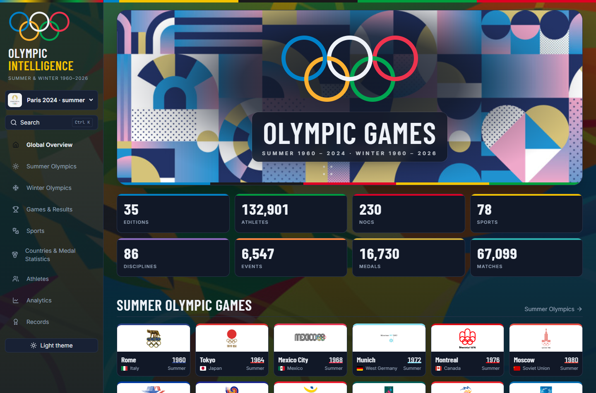
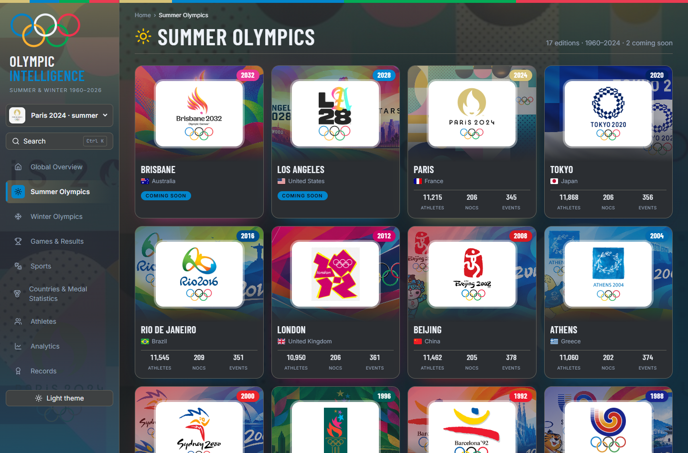
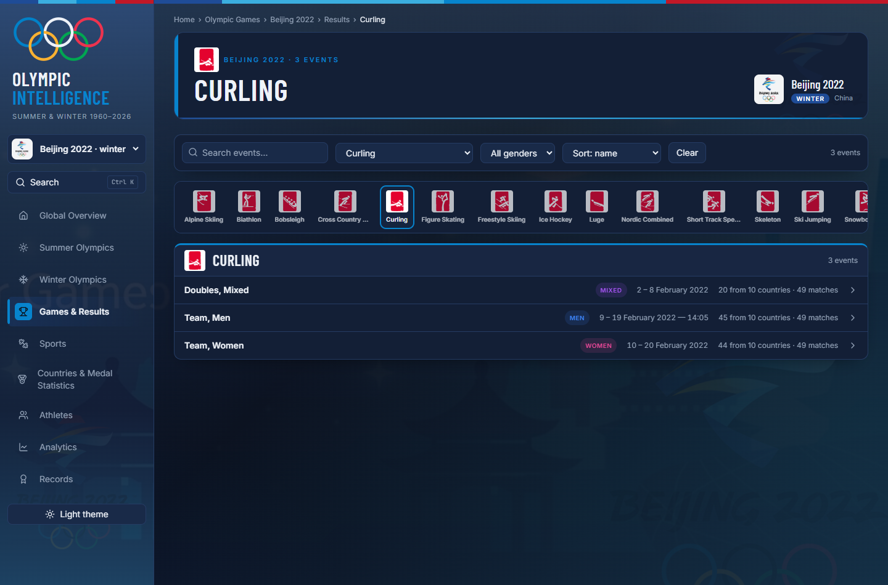
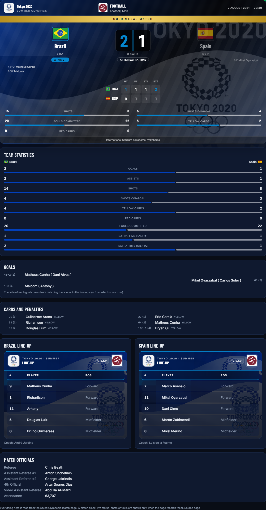
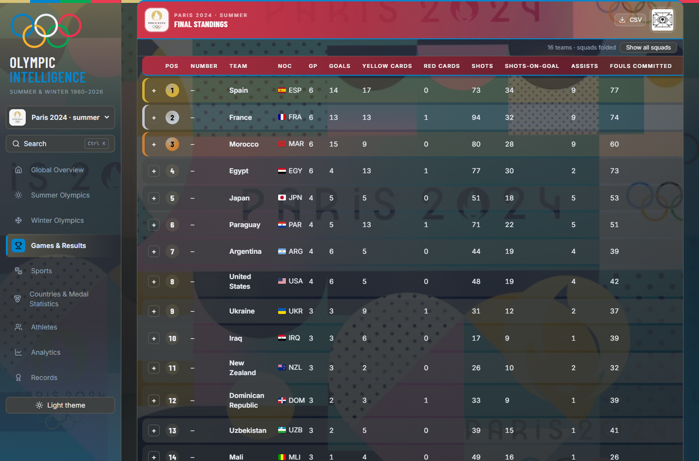
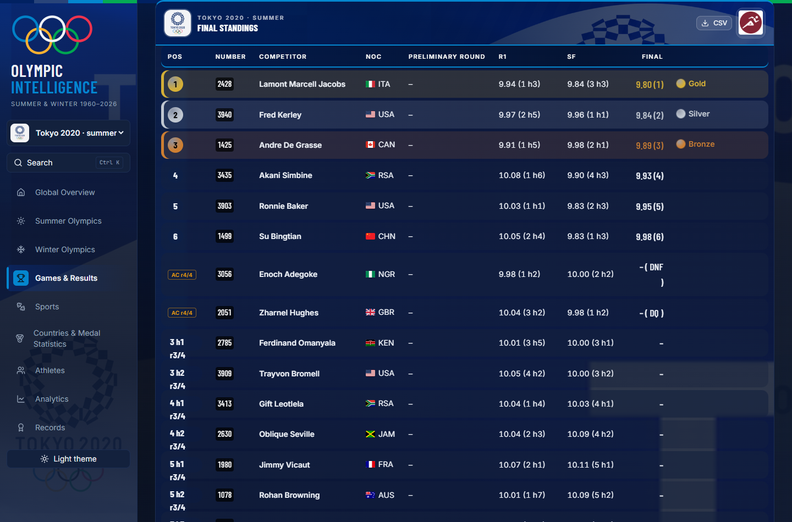
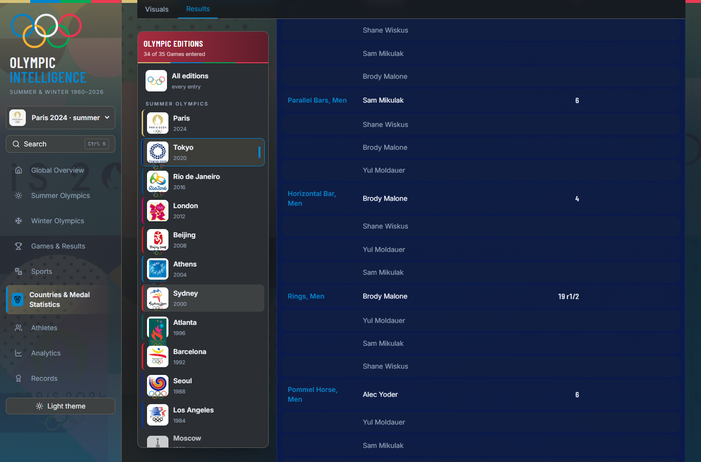

<div align="center">

# 🏅 Olympics Analysis

### Every Summer (1960–2024) and Winter (1960–2026) Olympic Games — results, matches, medals, countries and athletes, in broadcast style

[](https://olympicsanaylsis.vercel.app)
&nbsp;


**👉 [olympicsanaylsis.vercel.app](https://olympicsanaylsis.vercel.app)**



</div>

---

## ✨ What it is

A full Olympic history platform built on a hand-built data warehouse: **35 Games**, **132,901 athletes**, **230 NOCs**, **6,547 events**, **16,730 medals** and **67,099 matches**. Every Games looks like itself — its own emblem, artwork, colours, mascots and sport pictograms run through the whole interface, from the menu bar to every table header and scoreboard.

| | |
|---|---|
| 🎨 **Edition themes** | Each of the 39 editions (incl. LA 2028 → Salt Lake 2034, *Coming soon*) restyles the site with colours extracted from its own logo, its background artwork and its emblem. |
| 🏟️ **Games & Results** | Edition → sport pictogram → event → full results, with every round, heat, match and bout as its own page (previous / next navigation, real Olympedia ids). |
| 📺 **Broadcast scoreboards** | Sport-specific boards: football (HT/FT/ET, scorers), basketball line scores, volleyball sets, ice hockey periods, curling ends with the hammer, baseball R-H-E, boxing corners, and TV-style leaderboards for athletics, swimming and gymnastics. |
| 🌍 **Countries & Medal Statistics** | Complete medal table of all 231 NOCs (historical NOCs kept separate), filters for season, years, edition, sport, gender and medal, plus a Visuals page. |
| 🗂️ **Country profiles** | *Visuals* (10 charts) and *Results*: a sidebar of every Games with its logo, and the country's full Olympedia table for any edition. |
| 🧑‍🤝‍🧑 **Athletes & Records** | 132k athletes, career rankings, Olympic and world records — every name, country, sport, event and Games is a link. |
| 📊 **Analytics** | 100+ interactive charts (time series, medals, athletes, sports, statistics, machine-learning backtests, team sports, data engineering). |
| ♿ **Usability** | Filters in the URL (shareable, Back/Forward restore filters and scroll), keyboard-safe dropdowns, phone layouts, dark and light themes, reduced-motion support. |

## 🖼️ Screenshots

| Edition gallery | Event results (pictograms) |
|---|---|
|  |  |
| **Broadcast scoreboard** | **Team standings (squads folded under +)** |
|  |  |
| **Heat / final table** | **Country results by edition** |
|  |  |

## 🏗️ Architecture

```
            ┌──────────────────────────┐        /api/*  (rewrite)        ┌──────────────────────────────┐
 browser ──►│  Vercel · React SPA      │ ───────────────────────────────►│  Hugging Face Space · Docker │
            │  frontend/  (Vite build) │                                 │  FastAPI  backend/api        │
            └──────────────────────────┘                                 │  SQLite warehouse (2.7 GB)   │
                                                                         └──────────────▲───────────────┘
                                                                                        │ first boot
                                                                         Hugging Face dataset (warehouse)
```

* **Frontend** — React 18 · TypeScript · Vite · Tailwind · TanStack Query/Table/Virtual · Recharts · Framer Motion. A central theme engine (`frontend/src/themes`) turns each edition's registry entry (logo, background, palette) into CSS variables used by every surface.
* **Backend** — FastAPI over a SQLite warehouse (`backend/api`): edition event index, event / match / bout / heat pages, medal tables, country results, participants, gender statistics, records, analytics and 100+ chart endpoints. Interactive docs at `/docs`.
* **Warehouse** — bronze → silver → gold layers loaded by the pipeline in `scripts/` and `backend/` from **Olympedia** (results pages, matches, country pages) and **Wikipedia** (editions, assets), with validation checks and provenance on every record. Nothing is invented: missing values stay empty.

## 🚀 Run locally

```bash
# backend (Python 3.12)
python -m venv .venv && . .venv/bin/activate        # Windows: .venv\Scripts\Activate.ps1
pip install -r requirements.txt
cp .env.example .env
# put the warehouse at data/olympics_warehouse.db (built by the pipeline, see below)
uvicorn backend.api.main:app --port 8000

# frontend
cd frontend
npm install
npm run dev            # http://127.0.0.1:5173  (proxies /api to :8000)
```

**Rebuilding the warehouse.** The 2.7 GB database is not stored in git. It is produced by the pipeline (`python scripts/run_pipeline.py`) which collects, cleans, validates and loads the sources; see [docs/ARCHITECTURE.md](docs/ARCHITECTURE.md) and [docs/SOURCE_COVERAGE.md](docs/SOURCE_COVERAGE.md).

## ☁️ Deployment

| Part | Where | How |
|---|---|---|
| Website | **Vercel** (free) — [olympicsanaylsis.vercel.app](https://olympicsanaylsis.vercel.app) | `cd frontend && vercel deploy --prod` · `frontend/vercel.json` rewrites `/api/*` to the API and serves the SPA |
| API | **Hugging Face Spaces** (free, Docker) | `deploy/huggingface/` (Dockerfile, start script, Space card); the warehouse is downloaded from a Hugging Face dataset on first boot |

## 🧪 Tests

```bash
pytest -q                     # backend API and data checks
cd frontend && npx vitest run # 238 frontend unit + live-API integration tests
```

## 📁 Project structure

```
backend/      FastAPI app, loaders, scrapers, validators, analytics
frontend/     React app (pages, broadcast tables & scoreboards, theme engine, charts)
scripts/      pipeline and build scripts (warehouse, asset registry, coverage)
deploy/       Hugging Face Space for the API
docs/         architecture, source coverage, screenshots
reports/      generated data-quality and coverage reports
```

## 📜 Data & credits

Results and biographical data come from [Olympedia](https://www.olympedia.org) and [Wikipedia](https://www.wikipedia.org); edition artwork belongs to its respective organising committees and is used here for a non-commercial, educational project. The Olympic rings are drawn in their official colours as an SVG. This project is not affiliated with the IOC.

<div align="center"><sub>Built with ❤️ for Olympic history · <a href="https://olympicsanaylsis.vercel.app">olympicsanaylsis.vercel.app</a></sub></div>
